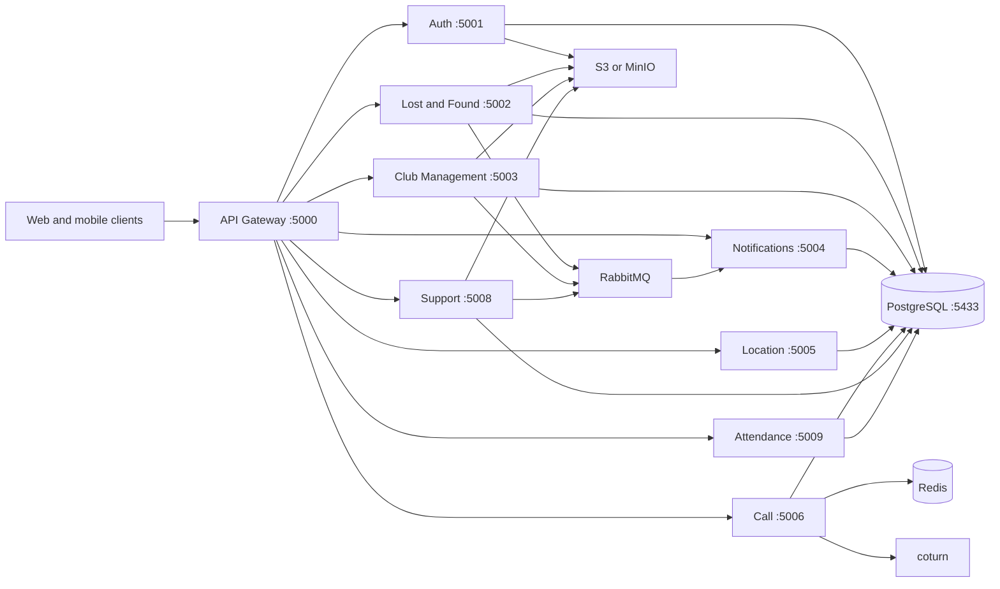

# MyADA Backend

MyADA is a campus platform backend: identity, clubs and events, attendance, lost and found, campus locations, support requests, in-app and email notifications, and realtime voice/video calls. It is a set of ASP.NET Core 8 services behind one YARP API gateway. Clients talk to the gateway. Each service owns its PostgreSQL database and applies Entity Framework migrations on startup.

The solution file for the platform is `MyAda.sln`. Attendance lives in its own solution, `Services/MyAdaAttendanceService/MyAdaAttendanceService.sln`, and is still built and routed by the root `docker-compose.yml`.

## Architecture



Most services follow the same layout: `Domain` (or `Core` for attendance), `Application`, `Infrastructure`, and an API/Web project. Shared code sits in `Shared/`:

| Project | Role |
|---|---|
| `Shared.Contracts` | Cross-service event contracts and the `notification-queue` name |
| `Shared.Infrastructure` | RabbitMQ publisher used by Lost and Found |
| `Shared.Observability` | Serilog file logs, OpenTelemetry, and Prometheus scraping |

## Services

Docker Compose publishes every API on the host ports below. Inside the compose network each service listens on `8080`.

| Service | Host port | Gateway prefix | Database | What it does |
|---|---|---|---|---|
| API Gateway | `5000` | — | — | YARP reverse proxy, CORS, `/health` |
| Auth | `5001` | `/api/auth` and `/auth` | `AuthDb` | Users, roles, RS256 JWT, password reset, profile photos |
| Lost and Found | `5002` | `/lostfound` | `LostFoundDb` | Lost and found items and categories |
| Club Management | `5003` | `/club` | `ClubDb` | Clubs, events, tickets, memberships, jobs, interviews |
| Notification | `5004` | `/notification` | `NotificationDb` | In-app notifications and SMTP email |
| Location | `5005` | `/location` | `MyAdaLocationDb` | Buildings, rooms, location validation |
| Call | `5006` | `/call` | `CallDb` | SignalR call signaling, call history, WebRTC ICE |
| Support | `5008` | `/support` | `MyAdaSupport` | Support requests, categories, attachments, staff status |
| Attendance | `5009` | `/attendance` | `my_ada_attendance_db` | Courses, lessons, sessions, QR attendance |

Gateway routes for `/orders` (`orders-service:8080`) and `/scheduling` (`host.docker.internal:5010`) are configured in `ApiGateway/appsettings.json`. Those services are not part of this Compose file.

### Gateway path rule

The gateway strips the service prefix and forwards the remainder. Auth is the exception: `/api/auth/...` is forwarded as-is, and `/auth/...` is an alias that also strips `/auth`.

```text
http://localhost:5000/club/api/v1/clubs
        → club service  /api/v1/clubs

http://localhost:5000/api/auth/login
        → auth service  /api/auth/login

http://localhost:5000/call/hub
        → call service  /hub
```

Swagger UI is enabled when a service runs with `ASPNETCORE_ENVIRONMENT=Development` (the Compose default for every service except the gateway). Open it through the gateway, for example `http://localhost:5000/club/swagger/index.html`.

`GET http://localhost:5000/health` returns `{ "status": "healthy" }`. The call service also exposes `GET /health`.

## Prerequisites

- [.NET SDK 8](https://dotnet.microsoft.com/download/dotnet/8.0) (`global.json` pins `8.0.100` and rolls forward to the latest 8.x feature band)
- Docker Desktop (or Docker Engine + Compose v2)
- An SMTP account if you start the notification service (Compose requires the variables below)
- Optional: MinIO or another S3-compatible store on `localhost:9000` for photo and attachment uploads

## Run the full stack

From the repository root.

### 1. JWT signing keys

Auth signs access tokens with the RSA private key in `keys/private.pem`. Other services can validate with `keys/public.pem` or with Auth’s JWKS document. If the key pair is missing:

```bash
bash scripts/generate-keys.sh
```

On Windows, with OpenSSL installed:

```powershell
New-Item -ItemType Directory -Force keys | Out-Null
openssl genrsa -out keys/private.pem 2048
openssl rsa -in keys/private.pem -pubout -out keys/public.pem
```

Compose mounts `keys/private.pem` and `keys/public.pem` into the auth container. Lost and Found also mounts the public key.

### 2. Notification email

Compose refuses to start the notification service until these variables are set. Put them in a `.env` file next to `docker-compose.yml` (that file is not committed) or export them in the shell.

| Variable | Purpose |
|---|---|
| `NOTIFICATION_SMTP_USERNAME` | SMTP username |
| `NOTIFICATION_SMTP_PASSWORD` | SMTP password |
| `NOTIFICATION_SMTP_FROM_EMAIL` | From address |

Optional overrides: `NOTIFICATION_SMTP_HOST` (default `smtp.gmail.com`), `NOTIFICATION_SMTP_PORT` (`587`), `NOTIFICATION_SMTP_FROM_NAME`, `NOTIFICATION_SMTP_ENABLE_SSL`.

### 3. Start

```bash
docker compose up --build
```

First startup builds the images and runs EF migrations as each API starts. Postgres data is kept in the `myada_postgres_data` volume.

Useful checks:

| Check | URL |
|---|---|
| Gateway | http://localhost:5000/health |
| RabbitMQ management | http://localhost:15672 (`myada` / `myada-password`) |
| Prometheus | http://localhost:9090 |
| Grafana | http://localhost:3000 (`admin` / `admin`) |
| Loki | http://localhost:3100 |

Stop the stack with `docker compose down`. Add `-v` only when you intend to delete Postgres, Grafana, and Loki volumes.

## Infrastructure started by Compose

| Component | Host ports | Local defaults |
|---|---|---|
| PostgreSQL 16 (`myada-db`) | `5433` → `5432` | user `postgres`, password `123` |
| RabbitMQ 3 management | `5672`, UI `15672` | user `myada`, password `myada-password` |
| Redis 7 | `6379` | no password |
| coturn | `3478` tcp/udp, relay `50100–50140` | shared secret `myada-turn-secret-change-me` |
| Loki, Promtail, Prometheus, Pushgateway, Grafana | `3100`, `9090`, `9091`, `3000` | Grafana `admin` / `admin` |

These values are local development defaults from `docker-compose.yml`. Override them with environment variables before using the stack anywhere shared. In particular set `TURN_SHARED_SECRET`, `TURN_PUBLIC_HOST`, `TURN_EXTERNAL_IP`, `RABBITMQ_DEFAULT_USER`, `RABBITMQ_DEFAULT_PASS`, and `GRAFANA_ADMIN_PASSWORD`.

### Object storage

Auth, Lost and Found, Club, and Support upload files to S3. Compose points them at MinIO on the Docker host:

- API: `http://host.docker.internal:9000`
- Public base: `http://localhost:9000/myada-app`
- Bucket: `myada-app` (created on startup when `S3__AutoCreateBucket=true`)
- Credentials: `minioadmin` / `minioadmin123`

MinIO itself is not defined in this Compose file. Run it on port 9000, or point the `*_S3_*` variables (`SUPPORT_S3_*`, `LOSTFOUND_S3_*`, `CLUB_S3_*`, and the auth aliases of the support values) at another bucket. Key prefixes are `users`, `lost-and-found`, `clubs`, and `support`.

### Messaging

Lost and Found, Club Management, and Support publish JSON messages to the durable queue `notification-queue`. Notification Service consumes that queue, stores an in-app notification for `recipientUserId`, and can send email. Publishing is best-effort: a down broker does not fail the originating API call.

Auth calls Notification Service over HTTP (`POST /api/v1/notifications/email`) for password-reset mail, and calls Support’s internal provisioning endpoint when a support staff user is created.

### Realtime

| Hub | Gateway URL | Direct URL | Auth |
|---|---|---|---|
| Calls | `http://localhost:5000/call/hub` | `http://localhost:5006/hub` | Bearer JWT |
| Support updates | `http://localhost:5000/support/hubs/support-updates` | `http://localhost:5008/hubs/support-updates` | Bearer JWT |

Call signaling uses Redis (`myada:call` channel prefix) for the SignalR backplane and for short-lived call state. ICE servers come from `GET /call/webrtc/ice-servers`. Compose enables TURN against the bundled coturn container; set `TURN_PUBLIC_HOST` to an address clients can actually reach.

## Authentication

Auth issues RS256 JWTs.

| Setting | Value |
|---|---|
| Issuer | `myada-auth` |
| Audience | `myada-api` |
| Algorithm | RS256 |
| Access token lifetime | 15 minutes |
| Refresh token lifetime | 30 days |
| JWKS | `GET /auth/.well-known/jwks.json` on the gateway, or `GET /.well-known/jwks.json` on the auth service |

Protected routes expect:

```http
Authorization: Bearer <accessToken>
```

Claims used by other services include `sub`, `email`, `firstName`, `organizationalId`, `userType`, and one or more `role` values.

Local bootstrap (empty auth database):

```http
GET http://localhost:5000/api/auth/create-admin
```

That creates a user `Admin` with password `Admin123*`. Use it only on a development database.

Login:

```http
POST http://localhost:5000/api/auth/login
Content-Type: application/json

{ "username": "Admin", "password": "Admin123*" }
```

Club event tickets use a separate signing key (`Tickets__SigningKey` in Compose, issuer `myada-tickets`, audience `myada-scanner`). Replace that key outside local development.

## Databases

One Postgres instance hosts every service database. Compose creates the server; each API creates its own database and schema via `Migrate()` / `MigrateAsync()` on startup.

| Database | Service | Compose connection name |
|---|---|---|
| `AuthDb` | Auth | `ConnectionStrings__Develop` |
| `LostFoundDb` | Lost and Found | `ConnectionStrings__Develop` |
| `ClubDb` | Club | `ConnectionStrings__Develop` |
| `NotificationDb` | Notification | `ConnectionStrings__Develop` |
| `MyAdaLocationDb` | Location | `ConnectionStrings__LocationService` |
| `CallDb` | Call | `ConnectionStrings__CallService` |
| `MyAdaSupport` | Support | `ConnectionStrings__DefaultConnection` |
| `my_ada_attendance_db` | Attendance | `ConnectionStrings__DefaultConnection` |

Club also receives `ConnectionStrings__Auth` so it can read auth data where the implementation does so.

From the host, connect to `localhost:5433`. From another Compose service, use host `myada` and port `5432`.

Attendance seeds lesson rows on startup when `Database__SeedLessonsIfEmpty=true` and the `Lessons` table is empty. See `Services/MyAdaAttendanceService/database/seed/README.md`. A larger auth and club seed script lives at `scripts/seed-auth-clubmanagement.sql`.

## Run one service without Compose

Start Postgres, Redis, and RabbitMQ first (the Compose file can start only those):

```bash
docker compose up myada rabbitmq myada-redis
```

Then, from the service project directory:

```bash
dotnet run --project Services/AuthService/AuthService.Api
```

Launch profiles bind the same host ports Compose uses for Auth (`5001`), Lost and Found (`5002`), Club (`5003`), Notification (`5004`), Location (`5005`), and the gateway (`5000`). Support, Call, and Attendance launch profiles use different ports (`5184`, `5053`, and `5159`). When the gateway runs with `ASPNETCORE_ENVIRONMENT=Development`, `ApiGateway/appsettings.Development.json` expects Support on `5008`, Call on `5006`, and Attendance on `5009`, matching Compose. Override `applicationUrl` or the gateway cluster address if you run those three from their launch profiles.

`appsettings.Development.json` in each service points at localhost. Several of those files assume Postgres on port `5433`; Call’s development file uses `5432`, and Support’s committed file uses port `5434`. Align the connection string with the database you actually started before `dotnet run`.

Attendance is built from its own solution:

```bash
dotnet run --project Services/MyAdaAttendanceService/MyAdaAttendanceService.Web
```

## Tests

Main solution:

```bash
dotnet test MyAda.sln
```

Attendance:

```bash
dotnet test Services/MyAdaAttendanceService/MyAdaAttendanceService.sln
```

Integration tests under `tests/` use `MyAda.Testing.Integration.Infrastructure` and `MyAda.Testing.JwksStub` so services can validate JWTs without a live auth container.

k6 scripts in `load-tests/k6/` cover event registration, ticket check-in, and attendance QR scan. They do not call delete endpoints. Setup and required environment variables are in `load-tests/k6/README.md`.

`scripts/Publish-TestResultsToGrafana.ps1` and `scripts/publish-k6-results-to-grafana.sh` push run results to Pushgateway (`localhost:9091`) so they show up on the provisioned Grafana dashboard `MyADA logs and tests`.

## Logs and metrics

Each API writes Serilog output under the shared Compose volume mounted at `/app/logs` (host path is the `myada_app_logs` volume). Promtail ships those files and Docker container logs to Loki. Prometheus scrapes `/metrics` on every service (see `observability/prometheus.yml`) and also scrapes Pushgateway.

Grafana provisioning is in `observability/grafana/`. The dashboard JSON is `observability/grafana/dashboards/myada-logs-and-tests.json`.

## Repository layout

```text
ApiGateway/                  YARP gateway
Services/
  AuthService/
  LostFoundService/
  ClubManagementService/
  NotificationService/
  LocationService/
  CallService/
  MyAdaSupportService/
  MyAdaAttendanceService/    own solution and Docker Compose file
Shared/                      contracts, messaging, observability
tests/                       cross-service test projects
observability/               Prometheus, Loki, Promtail, Grafana
scripts/                     key generation, SQL seed, Grafana publishers
load-tests/k6/               k6 load and stress scripts
keys/                        RSA key pair used by Compose
docker-compose.yml           full local stack
MyAda.sln
```

## API documentation

Endpoint inventories, request bodies, and role rules live in the docs below. Paths in those files are written against the gateway prefix.

| Area | Document |
|---|---|
| All services, gateway URLs | [FULL_GATEWAY_API_DOC.md](FULL_GATEWAY_API_DOC.md) |
| Routing and 404 causes | [FRONTEND_GATEWAY_ROUTING.md](FRONTEND_GATEWAY_ROUTING.md) |
| Auth | [AUTH_API_DOC.md](AUTH_API_DOC.md) |
| JWT and RSA checklist | [docs/JWT-RSA-Analysis-and-Checklist.md](docs/JWT-RSA-Analysis-and-Checklist.md) |
| Clubs, events, tickets | [CLUB_API_DOC.md](CLUB_API_DOC.md), [FRONTEND_CLUB_API_GUIDE.md](FRONTEND_CLUB_API_GUIDE.md) |
| Event registration | [FRONTEND_EVENT_REGISTRATION_API_GUIDE.md](FRONTEND_EVENT_REGISTRATION_API_GUIDE.md) |
| Interviews | [INTERVIEW_FRONTEND_DOC.md](INTERVIEW_FRONTEND_DOC.md) |
| Lost and Found | [Services/LostFoundService/LOSTFOUND_API.md](Services/LostFoundService/LOSTFOUND_API.md), [docs/LostFound-Frontend-API.md](docs/LostFound-Frontend-API.md) |
| Location | [LOCATION_API_DOC.md](LOCATION_API_DOC.md), [docs/LocationService-Frontend-API.md](docs/LocationService-Frontend-API.md) |
| Notifications | [NOTIFICATION_API_DOC.md](NOTIFICATION_API_DOC.md) |
| Calls | [CALL_API_DOC.md](CALL_API_DOC.md) |
| Support | [SUPPORT_API_DOC.md](SUPPORT_API_DOC.md), [Services/MyAdaSupportService/API_ENDPOINTS.md](Services/MyAdaSupportService/API_ENDPOINTS.md) |
| Attendance | [ATTENDANCE_API_DOC.md](ATTENDANCE_API_DOC.md), [Services/MyAdaAttendanceService/docs/ATTENDANCE_API.md](Services/MyAdaAttendanceService/docs/ATTENDANCE_API.md) |
| Attendance admin | [Services/MyAdaAttendanceService/docs/ADMIN_API.md](Services/MyAdaAttendanceService/docs/ADMIN_API.md) |
| Lesson Excel import | [Services/MyAdaAttendanceService/docs/LESSON_BULK_EXCEL.md](Services/MyAdaAttendanceService/docs/LESSON_BULK_EXCEL.md) |

### Surface each service exposes

Prefixes below are the path on the service. Through the gateway, add the prefix from the services table (`/club`, `/lostfound`, and so on). Auth stays at `/api/auth`.

**Auth** — `api/auth`, `api/auth/roles`, `api/auth/admin/users`

Login, refresh, logout, forgot/reset/change password, user lookup, profile photo upload, role assignment, admin user management.

**Club** — versioned `api/v1/...` (events also answer on `api/events`)

`clubs`, `categories`, `events`, `subevents`, `event-registrations`, `club-memberships`, `club-proposals`, `club-admin/{clubId}`, `applications`, `interviews`, `slots`, `vacancies`, `job-applications`, `club-position-requirements`, `student-services`, `users/me`.

**Lost and Found** — `api/lost-and-found`, `api/v1/categories`

**Location** — `api/v1/buildings`, `api/v1/rooms`, `api/v1/locations`

Building and room reads are anonymous. Writes require the `admin` role.

**Notification** — `api/v1/notifications`

List and delete the caller’s notifications, and send email.

**Call** — `api/call-history` (alias `api/calls/history`), `/hub`, `/webrtc/ice-servers`

**Support** — `api/Requests`, `api/Categories`, `api/Attachments`, `api/SupportStaffStatuses`, `/hubs/support-updates`

Staff provisioning from Auth uses `POST api/SupportStaffStatuses/internal/provision` with the `X-Internal-Key` header. The expected value is `InternalAuth:ProvisioningKey` (`myada-internal-key` in local Compose), and Auth sends the same value as `SupportService:ProvisioningKey`.

**Attendance** — `api/admin`, `api/students/{studentId}`, `api/instructors/{instructorId}/lessons`, `api/instructors/{instructorId}/sessions`

Collection GETs accept `sortBy` and `sortDir`, plus `/search` and `/filter` on the same path. QR attendance tokens are short-lived (`QrToken:LifetimeSeconds`, 120 seconds in development).

## CORS

The gateway allows the origins in `ApiGateway/appsettings.json`:

- `http://localhost:3000`
- `http://localhost:5173`
- `https://my-ada-front-web.vercel.app`

`appsettings.Development.json` narrows that to `http://localhost:3000` when the gateway itself runs in Development (the `dotnet run` profile). The Compose gateway runs as Production and uses the broader list. Credentials are not allowed on the CORS policy. Add a new SPA origin to `Cors:AllowedOrigins` before calling the gateway from it.

## Configuration reference

Runtime settings are environment variables in Compose, which override `appsettings.json`. The pattern is ASP.NET Core’s `__` nesting (`Auth__JwksUrl` → `Auth:JwksUrl`).

| Area | Variables |
|---|---|
| JWT keys | `Jwt__PrivateKeyPath`, `Jwt__PublicKeyPath` |
| Downstream auth | `Auth__JwksUrl`, `Auth__Issuer`, `Auth__Audience` |
| Broker | `RabbitMQ__Host`, `RabbitMQ__Username`, `RabbitMQ__Password` |
| Uploads | `S3__BucketName`, `S3__Region`, `S3__AccessKey`, `S3__SecretKey`, `S3__ServiceUrl`, `S3__ForcePathStyle`, `S3__PublicBaseUrl`, `S3__KeyPrefix`, `S3__AutoCreateBucket` |
| Password reset link | `PasswordReset__ClientResetUrl` or `AUTH_PASSWORD_RESET_URL` |
| Calls | `Redis__ConnectionString`, `Call__InviteTimeoutSeconds`, `Turn__*` |
| Attendance seed | `Database__SeedLessonsIfEmpty` |
| Logs | `MYADA_LOG_DIR` |

## Typical local request

```bash
# 1. Bootstrap admin (once per empty AuthDb)
curl http://localhost:5000/api/auth/create-admin

# 2. Log in
curl -s http://localhost:5000/api/auth/login \
  -H "Content-Type: application/json" \
  -d "{\"username\":\"Admin\",\"password\":\"Admin123*\"}"

# 3. Call a protected route with the access token
curl http://localhost:5000/club/api/v1/clubs \
  -H "Authorization: Bearer <accessToken>"
```
